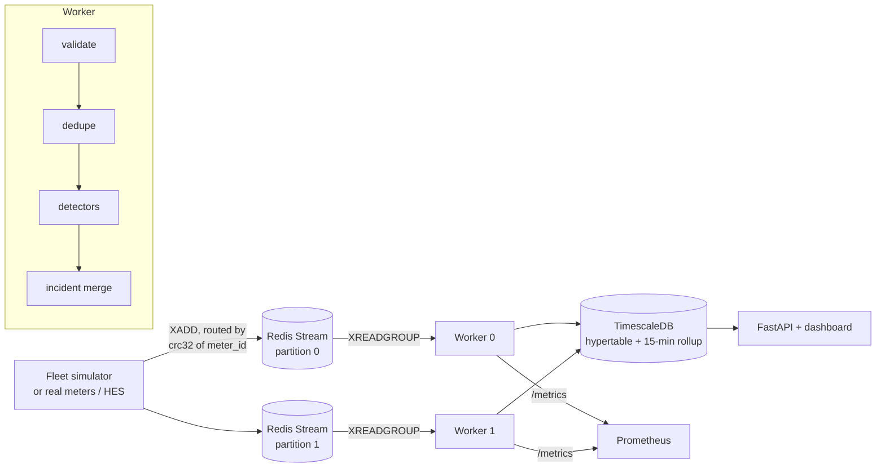

# meterstream

**A real-time smart-meter data platform: streaming ingest, anomaly and tamper detection, and
time-series storage, with infrastructure as code for Azure.**

A fleet of simulated electricity meters publishes 5-minute readings into partitioned Redis
Streams. Workers validate and deduplicate the readings and run streaming detectors for consumption
spikes, register tampering, reverse energy flow, outages and voltage sags or swells. They store
everything in TimescaleDB, and a dashboard shows the fleet live.

```
1000 meters x 7 days: 2,008,543 messages in 8.5s (237,416 msg/s, single process, in-memory)

| anomaly           | labels | precision | recall | F1    | median detection delay |
|-------------------|--------|-----------|--------|-------|------------------------|
| consumption_spike |    589 |     0.961 |  0.883 | 0.920 | 0 min                  |
| register_rollback |    642 |     1.000 |  0.997 | 0.998 | 0 min                  |
| reverse_flow      |    436 |     1.000 |  1.000 | 1.000 | 0 min                  |
| outage            |    559 |     1.000 |  1.000 | 1.000 | 15 min                 |
| voltage_sag       |    601 |     1.000 |  1.000 | 1.000 | 0 min                  |
| voltage_swell     |    578 |     1.000 |  0.998 | 0.999 | 0 min                  |
| overall           |   3405 |     0.994 |  0.979 | 0.986 |                        |
```
<sub>Output of `python -m eval.evaluate_detectors --meters 1000 --days 7`, scored against the
simulator's ground-truth labels. See [Evaluation](#evaluation) for what these numbers do and don't mean.</sub>

## Architecture



| Component | What it does |
|---|---|
| `simulator.py` | Household load curves (morning/evening peaks, weekend shift), 25% of homes with rooftop solar, noise, at-least-once duplicates, and **labelled** anomaly injection |
| `transport/` | Redis Streams with consumer groups, `XAUTOCLAIM` failover and capped stream length; partitioned by meter |
| `detectors/` | Streaming per-meter detectors, O(1) memory and work per reading |
| `incidents.py` | Merges runs of alerts into incidents (one event instead of fifty) |
| `pipeline.py` | consume → validate → dedupe → detect → store → **ack** |
| `storage/` | TimescaleDB hypertable, COPY-based batch writes, continuous aggregate, compression and retention |
| `api.py` + `dashboard.html` | REST API, live dashboard, Prometheus metrics |
| `infra/terraform/` | Azure Container Apps, Azure Cache for Redis, Azure Database for PostgreSQL (TimescaleDB), Log Analytics |

## Run it

```bash
pip install -e ".[dev]"
meterstream demo                 # all in one process, in memory → http://localhost:8000
```

Full stack (Redis, TimescaleDB, two workers, API, Prometheus):

```bash
docker compose up --build        # dashboard :8000, Prometheus :9090
```

Deploy to Azure:

```bash
cd infra/terraform
cp terraform.tfvars.example terraform.tfvars   # subscription id + image
terraform init && terraform apply              # prints dashboard_url
```

You can also run the **Deploy** GitHub Action. It builds the image, pushes it to GHCR, and applies
Terraform using OIDC federated credentials, so no cloud keys are stored in GitHub.

## Detectors

| Anomaly | Method | Why |
|---|---|---|
| Consumption spike | EWMA of **log** power per meter **per hour of day**; alert at z > 4 *and* ≥ 3x the usual level | 3 kW at 7 pm is normal and 3 kW at 3 am isn't. The log scale makes it a ratio test ("8x usual"), which suits loads from 0.1 to 10 kW. Anomalies aren't fed back into the baseline. |
| Register rollback | Cumulative import register decreased | Registers are monotonic, so a decrease means tampering or a reset |
| Reverse flow | Export register increased on a meter with no registered generation | A classic bypass/tamper signature; meters with solar are exempt via the asset registry |
| Outage | No reading for 3+ intervals (sweep), closed on restore | Detection runs on **event time**, so replaying a backlog doesn't flag every meter as silent |
| Voltage sag/swell | Outside nominal ±10% (230 V: 207–253 V) | Statutory supply limits (EN 50160) |

## Design decisions

- **Partition by meter, not round-robin.** Detectors are stateful per meter (baselines, last
  register value). With one shared consumer group, a meter's readings would be spread across workers
  and every baseline would be wrong. Readings are routed to `stream:{crc32(meter_id) % N}` and each
  worker owns one partition, the same model as Kafka partitions. Terraform creates one
  single-replica Container App per partition.
- **At-least-once delivery, idempotent writes.** Messages are acked only after readings and
  incidents are stored. A crash means redelivery, which is harmless: the `(meter_id, ts)` primary key
  drops duplicate rows, and detectors skip readings they've already seen. A test kills a worker
  mid-batch and checks that every reading is stored exactly once.
- **Event time over wall-clock time.** Housekeeping (outage sweeps, closing incidents) uses a
  watermark of the newest reading seen, so backfills and replays behave like live traffic.
- **Batch writes with COPY.** Readings go into a temp table via `COPY`, then into the hypertable
  with one `INSERT ... ON CONFLICT DO NOTHING`. That's much faster than row-by-row inserts.
- **Graceful degradation on managed Postgres.** Compression, retention and continuous aggregates
  live in a separate optional schema (`schema_tsl.sql`). Managed services may only provide
  TimescaleDB's open-source edition, so if those features aren't available the store logs a warning
  and serves charts from raw `time_bucket` queries.
- **Measure the detectors.** The simulator records ground truth for every anomaly it injects, so
  precision, recall and detection delay are numbers rather than claims. CI fails if overall F1 on
  500 meters x 7 days drops below 0.95.

## Evaluation

```bash
python -m eval.evaluate_detectors --meters 1000 --days 14 --seed 7 --report eval-report.json
```

An incident counts as a true positive if it's on the right meter, of the right kind, and overlaps
the labelled window. Read the results with care:

- **The rule-based detectors score near-perfectly because the simulator injects exactly what they
  look for.** Real tampering is subtler, and real data has meter clock drift and firmware quirks.
  The value here is that the pipeline is correct end to end and the scoring method is in place, not
  that the 1.000s are realistic.
- **Spike detection is the interesting one** (F1 ≈ 0.92): it has to separate real spikes from normal
  evening peaks and noise. Most of the misses are spikes on solar homes during daylight, which are
  deliberately skipped (see the next point).
- **Net metering hides load.** Homes with solar report *net* power, which swings with cloud cover,
  so spike checks are skipped on those meters in daylight. Getting gross consumption needs separate
  generation metering.
- **Throughput** (≈ 240k msg/s) is the single-process in-memory pipeline: detectors plus incident
  tracking. With Redis and TimescaleDB, the network and database write speed set the limit.

## Tests

```bash
pytest -q        # unit tests; Redis and TimescaleDB integration tests run when their URLs are set
```

CI runs the integration tests against real Redis and TimescaleDB service containers. It also runs
the detector quality gate, builds and smoke-tests the Docker image, and runs `terraform validate`.

## Limitations and next steps

- Exactly-once incident *notifications* (webhook/email) would need an outbox table.
- Repartitioning (changing N) needs a coordinated drain; consistent hashing would make that smoother.
- Detector state is in memory. A worker restart re-learns spike baselines, which takes about 3 days
  per hour bucket. Snapshotting state to Redis would avoid that.
- Real meters speak DLMS/COSEM via a head-end system. An adapter would publish those readings into
  the same stream format.
- The Terraform uses public endpoints with an "allow Azure services" firewall rule. Production
  should use VNet integration and private endpoints.

## License

MIT
